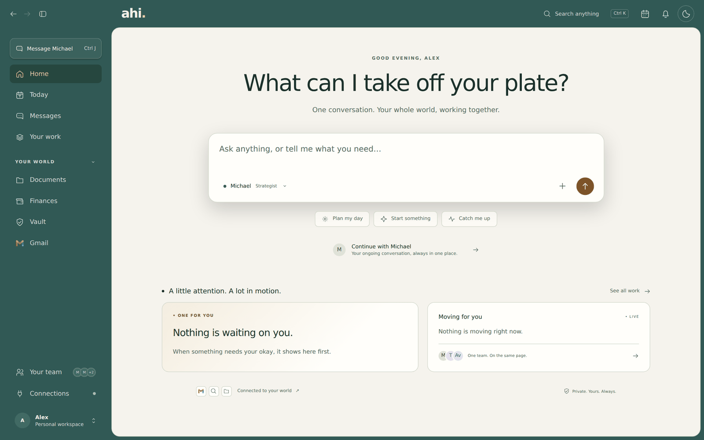
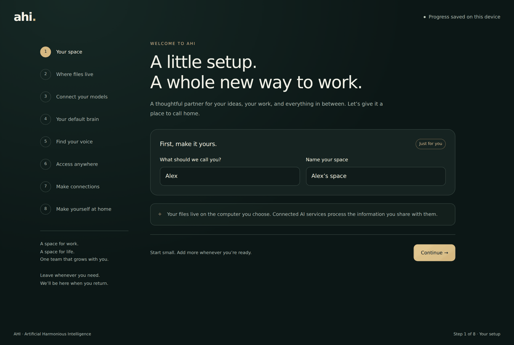
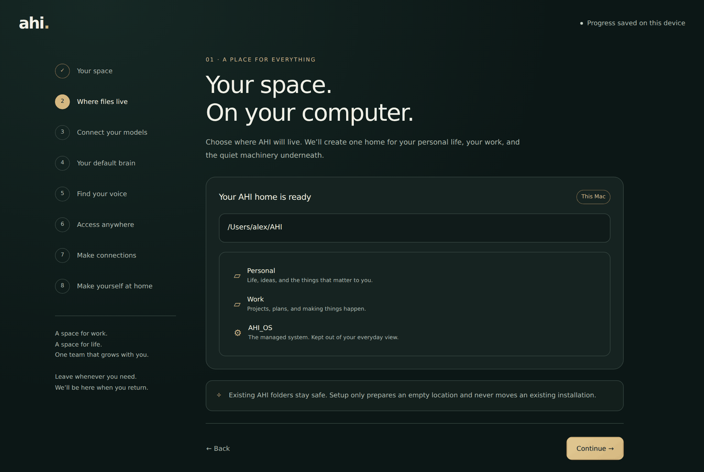
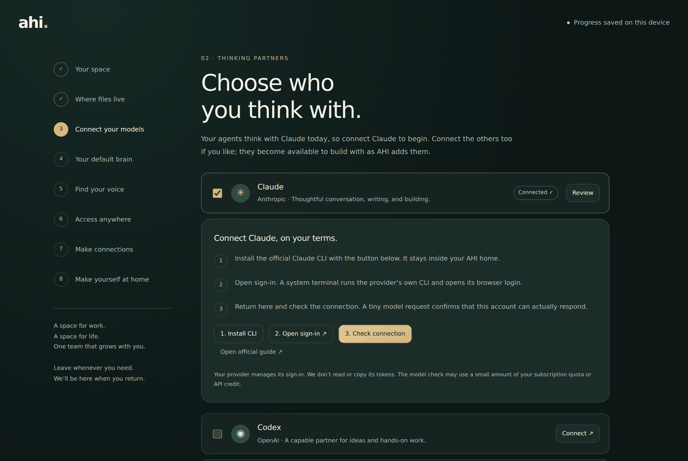
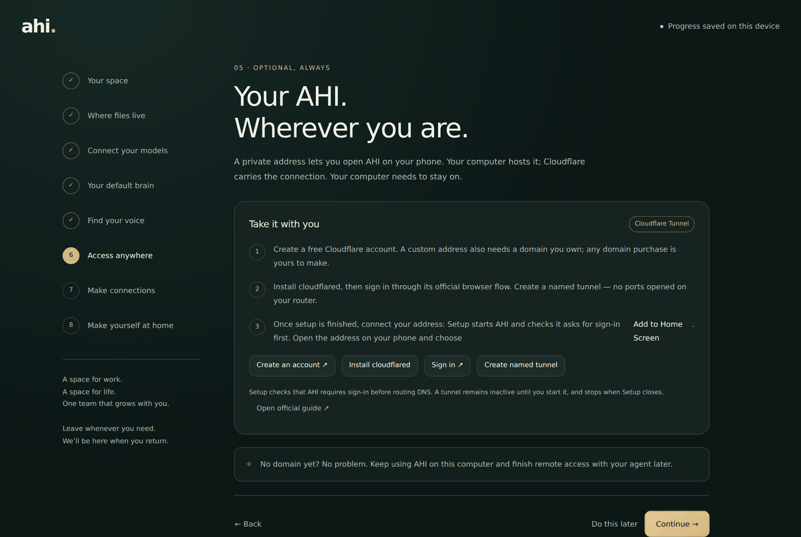
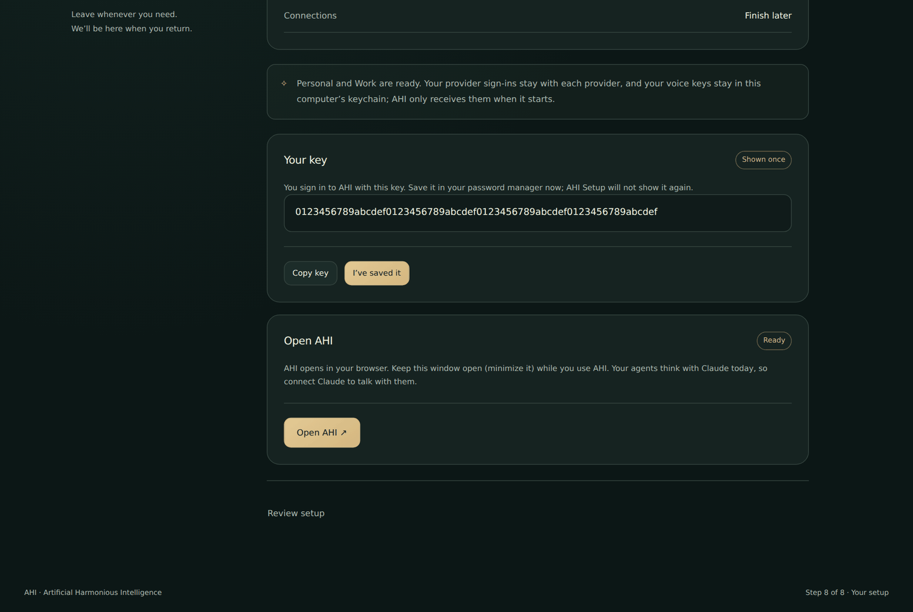
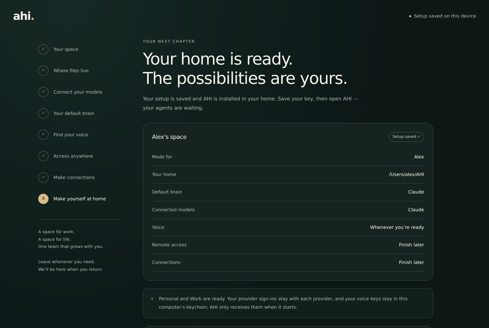
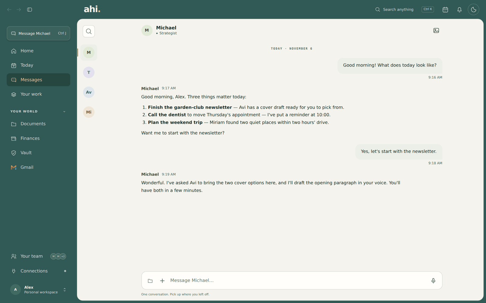

  

<h1 align="center">AHI</h1>

  <b>A small, thoughtful team of AI helpers that lives on your own computer.</b> 
  You talk with them like people. They plan, write, design and keep track — with you.

  <a href="#download"><b>Download</b></a> &nbsp;·&nbsp;
  <a href="#setting-up">See the setup</a> &nbsp;·&nbsp;
  <a href="#your-data">Your data</a>

  

## What is AHI?

AHI is four AI agents, each with its own character, working together for you. They live in a calm app that opens in your browser. You can type, talk by voice, and — if you like — open AHI on your phone.

- **Michael** — your right hand. Plans, coordinates, keeps track, and brings the important decisions back to you.
- **Tzali** — builds and fixes software and keeps your setup running.
- **Avi** — design: turns ideas into thoughtful visuals and products.
- **Miriam** — your personal assistant: your calendar, your documents, and a patient ear.

You can change how they talk to you; you can't change who they are.

## Download

Get **AHI Setup** from the **[latest release](https://github.com/AdamDehry/ahi/releases/latest)** and pick the one file for your computer:

| Your computer | The file to download |
|---|---|
| **Mac with an Apple chip** (M1, M2, M3…) | the one ending in `mac-arm64.dmg` |
| **Mac with an Intel processor** | the one ending in `mac-x64.dmg` |
| **Windows** | the one ending in `win-x64.exe` |
| **Linux** | the one ending in `linux-x86_64.AppImage` |

Not sure which Mac you have? Apple menu → **About This Mac**: it says **Chip** (Apple) or **Processor** (Intel).

The `.blockmap` files and `ahi-skills.json` on the release page are for automatic updates — you don't need to download them.

> AHI Setup isn't code-signed yet, so your computer will ask before opening it the first time.
> **Mac:** open it once, then go to **System Settings → Privacy & Security** and click **Open Anyway** (on older macOS, right-click AHI Setup and choose **Open**).
> **Windows:** choose **More info → Run anyway**.
> **Linux:** allow the file to run as a program (right-click → Properties), then open it.

## Setting up

Open AHI Setup and it walks you through everything in about 10–15 minutes. No terminal, no code.

<table>
  <tr>
    <td width="50%" valign="top">
       
      <b>1. Welcome.</b> Tell AHI your name and name your space.
    </td>
    <td width="50%" valign="top">
       
      <b>2. Your workspace.</b> Choose a folder. AHI makes one home inside it with <b>Personal</b> and <b>Work</b>, plus a hidden system folder.
    </td>
  </tr>
  <tr>
    <td width="50%" valign="top">
       
      <b>3. Connect Claude.</b> Setup installs Claude's official tool and you sign in with your own account. AHI never sees your password.
    </td>
    <td width="50%" valign="top">
       
      <b>4. Remote access — optional.</b> A private address so AHI opens on your phone, through Cloudflare. Skip it and add it later.
    </td>
  </tr>
  <tr>
    <td width="50%" valign="top">
       
      <b>5. Your key.</b> Shown once. Save it in your password manager — it's how you sign in to AHI.
    </td>
    <td width="50%" valign="top">
       
      <b>6. Open AHI.</b> Click <b>Open AHI</b> and it opens in your browser. Keep AHI Setup open (minimized is fine) while you use AHI.
    </td>
  </tr>
</table>

Along the way you can also add a voice and pick the services you'd like to connect. Both are optional, and you can come back to them anytime.

Then just talk. Here is a morning with Michael:

  

Screenshots use sample data (a person named Alex and a made-up key).

## What you need

- **A Claude account.** The agents think with Claude today. You sign in with your own account in Claude's official tool.
- **Optional:** an OpenAI, Cartesia, ElevenLabs or Google key for spoken replies and voice calls with any agent.
- **Optional:** a Cloudflare account and a domain, for a private address to open AHI from your phone.
- Gmail, Calendar, Drive, Telegram and more start unconnected. Link the ones you want during setup or later from **Connections**.

## Your data

Everything lives on your computer, in the folder you chose. Your agents' memory, your documents and your settings are files you own. AHI sends a conversation to the model you connected only when you talk to an agent, and it never sends your key or your files anywhere else.

The agents' souls and library live in the hidden system folder (`AHI_OS`). They're readable files, nothing secret; to change how an agent works, ask Michael rather than editing them by hand.

## Good to know

- AHI runs while AHI Setup is open. Close it and AHI stops; open it again and AHI starts.
- **Staying up to date:** open **Settings → Updates**. AHI tells you when a newer release is out. New and improved skills install with **Update skills** (anything they replace is kept in `AHI_OS/skills/_backup/`); a newer AHI itself comes as a new AHI Setup from the same release page. Your folder and memory stay.
- The agents run on Claude for now. Other providers can be connected in setup, and will be able to run agents in a later version.

---

## For developers

How the repo is laid out, how to build the server, the web app and AHI Setup, how supervised builds (Linux) work, and how skills are versioned and published: **[docs/DEVELOPERS.md](docs/DEVELOPERS.md)**.

## License

See [LICENSE](LICENSE).
